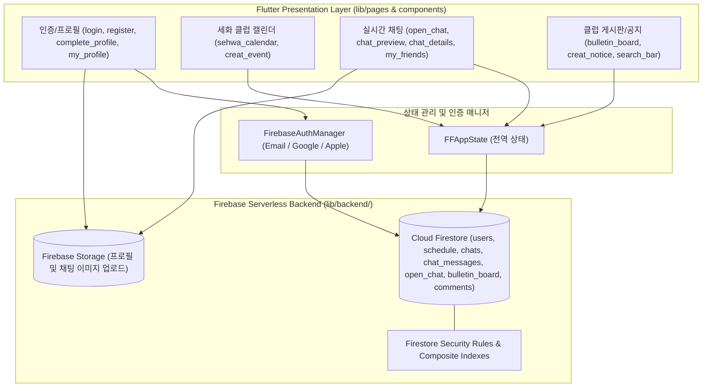

# 📱 SquashApp (세화 스쿼시 클럽 전용 커뮤니티 모바일 앱)


> **세화 스쿼시(Sehwa Squash) 동호회 회원들의 정기 모임 캘린더 공유, 오픈채팅/1:1 채팅, 클럽 공지 및 게시판 소통을 위해 구축한 Flutter + Firebase 기반 크로스플랫폼 모바일 앱**

---

## 1. 목적 및 문제 정의 (Why)

오프라인 스쿼시 클럽(세화 스쿼시) 운영 시 일반 단체 메신저만으로는 **정기 운동/레슨 일정(캘린더)과 중요 공지사항이 일상 대화에 묻혀 유실되는 문제**가 발생합니다.

본 프로젝트(`sehwa_s_q`)는 클럽 회원 전용 모바일 공간을 마련하여:
1. 날짜별 클럽 일정·번개 이벤트를 전용 캘린더(`sehwa_calendar`)에서 직관적으로 등록·확인하고,
2. 클럽 전체 오픈채팅(`open_chat`)과 친구 간 1:1 채팅(`chat_details`)을 분리하며,
3. 공지사항·자유게시판(`bulletin_board`)과 회원 프로필을 체계적으로 관리하기 위해 제작되었습니다.

---

## 2. 핵심 기능 및 해결 방식 (What)

1. **다중 소셜 및 이메일 통합 인증 (`lib/auth/`)**
   - 이메일/비밀번호 회원가입·로그인·비밀번호 재설정뿐만 아니라 Google, Apple, GitHub, 익명 인증까지 포괄하는 `FirebaseAuthManager` 계층을 갖추고 있습니다.
   - 가입 직후 프로필 완성(`complete_profile`), 프로필 수정(`edit_profile`), 개인 고유 테마 컬러(`OwnColorStruct`) 설정을 지원합니다.
2. **세화 스쿼시 전용 일정 캘린더 (`lib/pages/sehwa_calendar/` & `creat_event`)**
   - 날짜 선택 구조체(`OnDateSelectedStruct`)와 Firestore `schedule` 컬렉션을 연동하여 월간·일간 클럽 운동 일정 및 대회 일정을 등록·조회합니다.
3. **이원화된 실시간 채팅 시스템 (`lib/pages/chat/`)**
   - **오픈 채팅 (`open_chat`)**: 클럽 전체 회원이 실시간으로 참여하는 공개 대화방 (`open_chat`, `open_chat_message` 스키마)
   - **1:1 및 그룹 채팅 (`chat_preview`, `chat_details`, `my_friends`)**: 회원 목록 검색 및 친구 기반 개별 대화방 + 이미지 첨부 전송 (`Firebase Storage` 연동)
4. **클럽 게시판 및 공지 관리 (`lib/bulletin_board/` & `creat_notice`)**
   - 공지 등록 바텀시트/컴포넌트, 게시글 작성, 댓글(`comments_record.dart`) 및 키워드 검색바(`search_bar`) 기능을 제공합니다.

---

## 3. 시스템 아키텍처 및 디렉토리 구조 (How)

### 데이터 및 화면 아키텍처



### 디렉토리 구조

```text
squashapp/
├── lib/
│   ├── main.dart                     # 앱 진입점, Firebase 초기화 및 GoRouter 네비게이션 구동
│   ├── app_state.dart                # 앱 전역 상태 관리
│   ├── auth/                         # Firebase 다중 인증 프로바이더 (Email, Google, Apple 등)
│   ├── backend/
│   │   ├── firebase/                 # Firebase 플랫폼별 초기화 설정
│   │   ├── firebase_storage/         # 이미지/미디어 업로드 스토리지 헬퍼
│   │   └── schema/                   # 8종 Firestore 컬렉션 레코드 모델, 커스텀 Struct, 보안 규칙(firestore.rules)
│   ├── bulletin_board/               # 클럽 게시판 및 댓글 화면/모델
│   ├── components/                   # 일정 생성(creat_event), 공지 작성(creat_notice), 친구 목록, 검색바 위젯
│   ├── pages/
│   │   ├── sehwa_calendar/           # 세화 스쿼시 일정 캘린더 메인 페이지
│   │   ├── chat/                     # 오픈채팅, 채팅 미리보기, 상세 대화방, 친구 목록 페이지
│   │   └── user_info/                # 로그인, 회원가입, 비밀번호 변경/찾기, 프로필 관리 페이지
│   └── flutter_flow/                 # 공통 테마, 캘린더, 애니메이션, 라우팅 유틸리티
├── android/                          # Android 네이티브 빌드 설정
├── ios/                              # iOS 네이티브 빌드 및 푸시 알림(ImageNotification) 설정
└── pubspec.yaml                      # Flutter 패키지 및 에셋 의존성 정의
```

---

## 4. 로컬 실행 가이드 (Quick Start)

### 사전 요구 사항

- **Flutter SDK** (`>=3.0.0 <4.0.0`)
- Android Studio (Android SDK) 또는 Xcode (macOS/iOS 빌드 시)
- Firebase 프로젝트 연동 설정 (자체 테스트 환경 구축 시 `flutterfire configure`를 통해 본인 Firebase 프로젝트 구성을 생성하여 사용하는 것을 권장합니다)

### 설치 및 실행 명령어

```bash
# 1. Dart / Flutter 패키지 의존성 설치
flutter pub get

# 2. 연결된 디바이스 또는 에뮬레이터 확인
flutter devices

# 3. 디버그 모드로 앱 실행
flutter run
```
